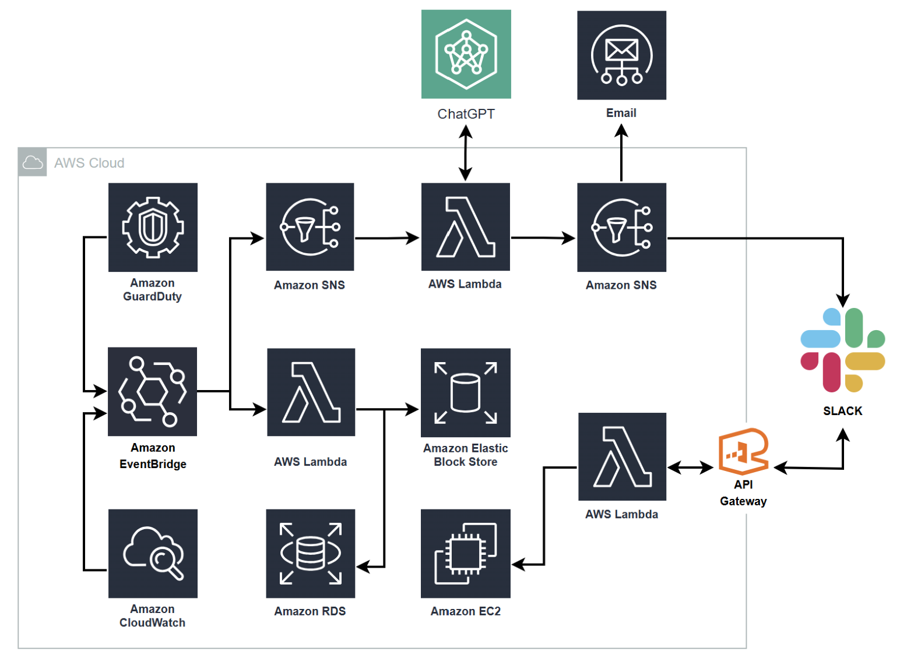

# WEARE · AWS 보안 자동화

**AWS 계정에서 발생하는 보안 이벤트를 감지하고, Slack 알림과 대응 작업으로 연결하는 프로젝트입니다.**

2025년 2학기 창의융합 자유연구 프로그램에서 진행했습니다. 계정 활동, 위협 탐지 결과, 리소스 설정 변경을 여러 콘솔에서 각각 확인해야 하는 문제를 줄이기 위해 AWS 이벤트를 한곳에 모으고, 반복되는 대응을 Lambda로 자동화했습니다.

## 전체 아키텍처

## 어떤 이벤트를 처리하나요?

| 이벤트 | 처리 흐름 |
| --- | --- |
| 해외 IP에서 발생한 계정 활동 | CloudTrail 로그를 CloudWatch Logs로 전달하고, Lambda에서 GeoIP 정보로 접속 위치를 확인해 알림을 보냅니다. |
| 루트 계정 로그인 | 미국 동부 리전에서 로그인 이벤트를 잡고, EventBridge로 서울 리전의 이벤트 버스에 전달합니다. |
| GuardDuty 탐지 결과 | 탐지 결과를 EventBridge로 받아 Lambda에서 알림을 구성합니다. 탐지 내용을 이해하는 데 도움이 되도록 OpenAI 기반 분석도 연결했습니다. |
| EBS·RDS 스냅샷 공개 설정 | AWS Config 규칙으로 공개 여부를 확인하고, 비준수 이벤트가 발생하면 Lambda로 공개 설정을 해제하는 흐름을 구성했습니다. |

알림은 SNS와 Lambda를 거쳐 Slack으로 전달합니다. Slack에서 요청한 대응 작업을 처리하는 Lambda와 EC2 격리에 사용하는 보안 그룹도 템플릿에 포함되어 있습니다.

## SAM 템플릿

- [`packaged.yaml`](packaged.yaml) · 서울 리전의 이벤트 수집, Slack 알림, 스냅샷 대응 구성
- [`packaged-us.yaml`](packaged-us.yaml) · 루트 계정 로그인 이벤트를 서울 리전으로 전달하는 구성

두 파일은 당시 패키징한 배포 템플릿입니다. 함수 코드와 GeoIP 레이어는 기존 S3 아티팩트를 참조합니다. 새 계정에서 다시 배포하려면 해당 아티팩트를 준비하고, 리전 간 이벤트 전달과 Lambda 실행에 필요한 IAM 역할을 계정에 맞게 설정해야 합니다.

## 연구결과보고서

[창의융합 자유연구 프로그램(2025-2학기) 연구결과보고서_WEARE.pdf](https://github.com/user-attachments/files/25567134/2025-2._WEARE.pdf)
